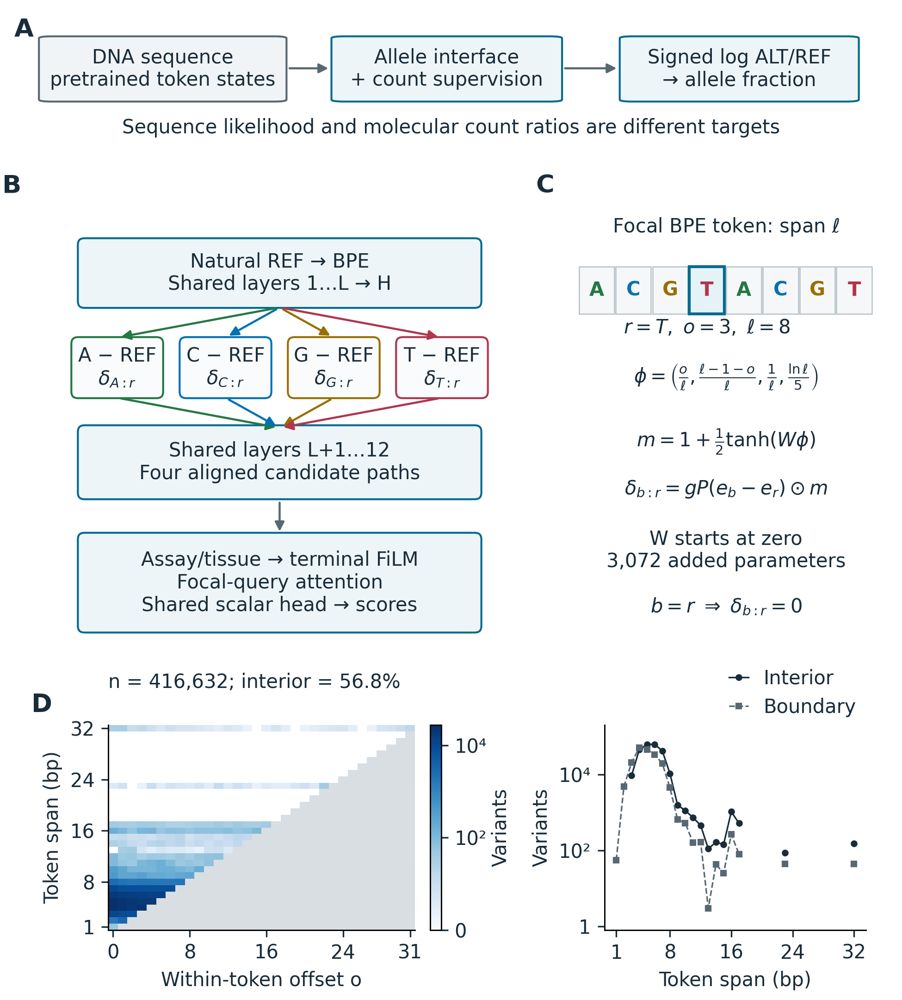

# LateBranch-DNABERT

**An explicit allele interface for DNABERT-2: shared reference context, localized candidate interventions, and count-supervised log-ratio prediction.**

LateBranch encodes a natural reference sequence once, introduces A/C/G/T candidate updates at the variant's BPE token, and processes those candidates through shared upper layers. An assay/tissue-conditioned attention readout produces relative potentials. Their ALT-minus-REF difference predicts a signed allelic log ratio and an ALT fraction.



## Start here

- [Method and design](docs/method.md): why token pretraining needs an allelic prediction interface, and how the intervention is encoded.
- [Input format](docs/data.md): centered REF windows, allele identities, conditions and optional counts.
- [Positive report](reports/positive.pdf): six pages answering the three scientific questions, with four figures and four tables; snapshot dated October 22, 2026.
- [Complete result tables](results/README.md): raw/calibrated metrics and paired intervals, including the subsequently completed controls.
- [Figure gallery](figures/README.md): design, predictive results, sequence logos and pattern–attention alignment.
- [Releases](https://github.com/XiangqiWang77/latebranch-dnabert/releases): trained checkpoint, figure/table downloads and report source with compact evidence.

This repository contains the maintained model interface and selected research outputs. Installation and prediction do not depend on our cluster directories or scheduler.

## Installation

Use Python 3.10. The package pins the DNABERT-compatible Transformers/tokenizer versions; the [tested environment](docs/tested_environment.json) records the exact validation environment.

```bash
git clone https://github.com/XiangqiWang77/latebranch-dnabert.git
cd latebranch-dnabert
python -m venv .venv
source .venv/bin/activate
python -m pip install -e .
```

PyTorch must match your CPU/CUDA installation; see its [official installation instructions](https://pytorch.org/get-started/locally/). CPU inference is supported. Training a full DNABERT model is intended for a suitable GPU.

## Download and predict

The backbone is the official DNABERT-2 checkpoint at a **fixed revision**. Its code, tokenizer, configuration and weight digests are checked before loading. The LateBranch release contains the adapted weights; the frozen backbone is downloaded separately.

```bash
latebranch download-backbone --output models/dnabert2
python scripts/download_checkpoint.py --output models

latebranch predict \
  --input examples/variants.csv \
  --checkpoint models/latebranch-window.pt \
  --backbone models/dnabert2 \
  --calibration configs/released_calibration.json \
  --output runs/example/predictions.csv \
  --device cpu
```

The example contains **synthetic DNA queries**, including the identity REF=ALT control. It demonstrates the interface, not biological performance. [Expected outputs](examples/expected_predictions.csv) are included for this checkpoint. Small floating-point differences across hardware are normal.

| Output | Meaning |
|---|---|
| `tau_forward`, `tau_reverse` | Logits from the two strand views |
| `tau_raw` | Their arithmetic mean, before assay calibration |
| `tau` | Calibrated log ALT/REF; equals `tau_raw` when no calibration file is supplied |
| `p_alt` | `sigmoid(tau)` |
| `rho` | Training-fitted assay dispersion used by the count likelihood |

Assays and tissues must belong to the [released checkpoint vocabulary](configs/released_model.json). The model uses assay and tissue conditions; chromosome and donor identifiers are not inputs to its prediction.

## Train on your data

Supply explicit `train` and `validation` partitions and dependence-group identifiers. The CLI checks that a group or identical reference window does not cross partitions. It does not invent splits or evaluate test rows during fitting.

```bash
latebranch check-data --input data/observations.csv.gz --training
latebranch train \
  --input data/observations.csv.gz \
  --config configs/train.json \
  --backbone models/dnabert2 \
  --output runs/my-study \
  --device cuda
```

Default settings follow the count-only protocol: seed 13, one epoch adapting added modules, then adaptation of the last four backbone blocks, validation NLL checkpoint selection, and a maximum of eight epochs. Training-only assay dispersions are fitted unless supplied explicitly. Set `model_type` to `vanilla` for the two-pass mean-pool reference; `branch_layer` and `position_aware` expose LateBranch's injection choices. These are model options, not a declaration of an optimal depth.

See [training, calibration and evaluation](docs/reproduction.md) for the complete workflow. Pretraining itself is not repeated.

## Evidence and interpretation

The report distinguishes three claims: a task-specific mapping from sequence representations to allelic counts; a concrete intervention-inspired architecture; and measured predictive/pattern endpoints. The reported improvements are conditional on a fitted seed and evaluation protocol. Sequence-pattern and attention figures use a separately identified historical model; they are not evidence that the new position gate improves prediction.

| Material | Location |
|---|---|
| Core model and vanilla reference | [`latebranch/`](latebranch/) |
| Downloading and study-data conversion | [`scripts/`](scripts/) |
| Training settings and released model vocabulary | [`configs/`](configs/) |
| Small synthetic examples | [`examples/`](examples/) |
| Protocols, parity checks and dependency provenance | [`docs/`](docs/) |
| Complete compact result tables | [`results/`](results/) |
| Report and figure previews | [`reports/`](reports/), [`figures/`](figures/) |

Run the small CPU tests with `python -m unittest discover -s tests -v`. They require no model download. The released checkpoint also passes a separate comparison against the original implementation and saved predictions; see [checkpoint parity](docs/checkpoint_parity.json). The [installed CLI check](docs/package_validation.json) and [public-download verification](docs/release_verification.json) record the release checks.

## Attribution

LateBranch builds on [DNABERT-2](https://arxiv.org/abs/2306.15006) and uses the [EN-TEx resource](https://doi.org/10.1016/j.cell.2023.02.018) in its reported study. Intervention-based interpretation provides the design motivation; see [Geiger et al.](https://papers.nips.cc/paper/2021/hash/4f5c422f4d49a5a807eda27434231040-Abstract.html). A repository citation is provided in [CITATION.cff](CITATION.cff); no accepted-paper venue or paper DOI is implied.

The downloaded DNABERT-2 assets retain their Apache-2.0 license. [Third-party notices](THIRD_PARTY_NOTICES.md) identify the dependency and figure-workflow attribution. A project-wide open-source license for the original LateBranch code has not been specified by the authors.
