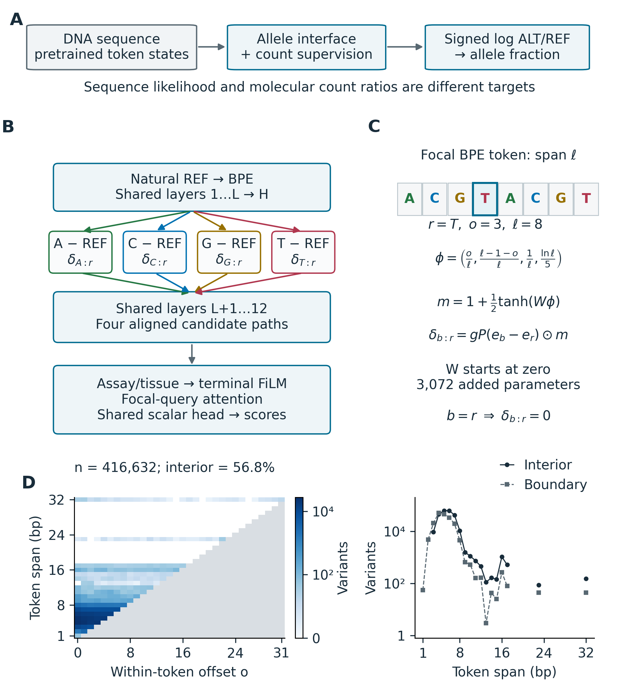
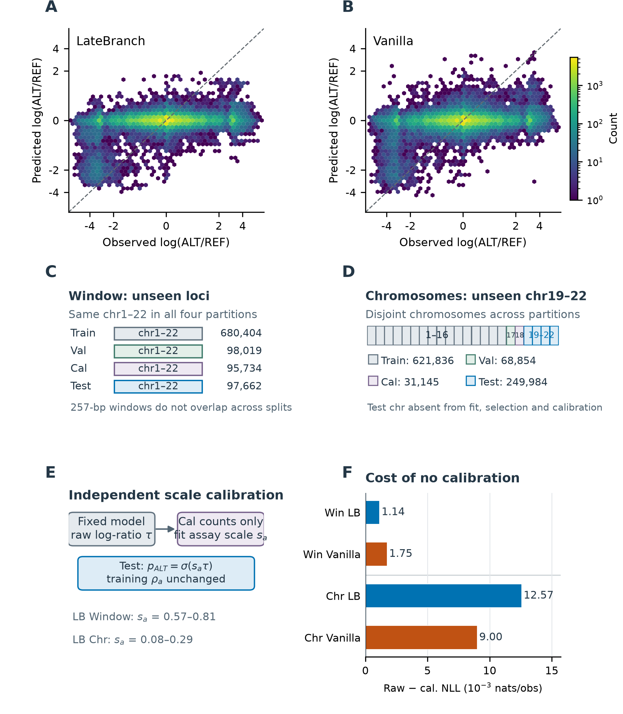
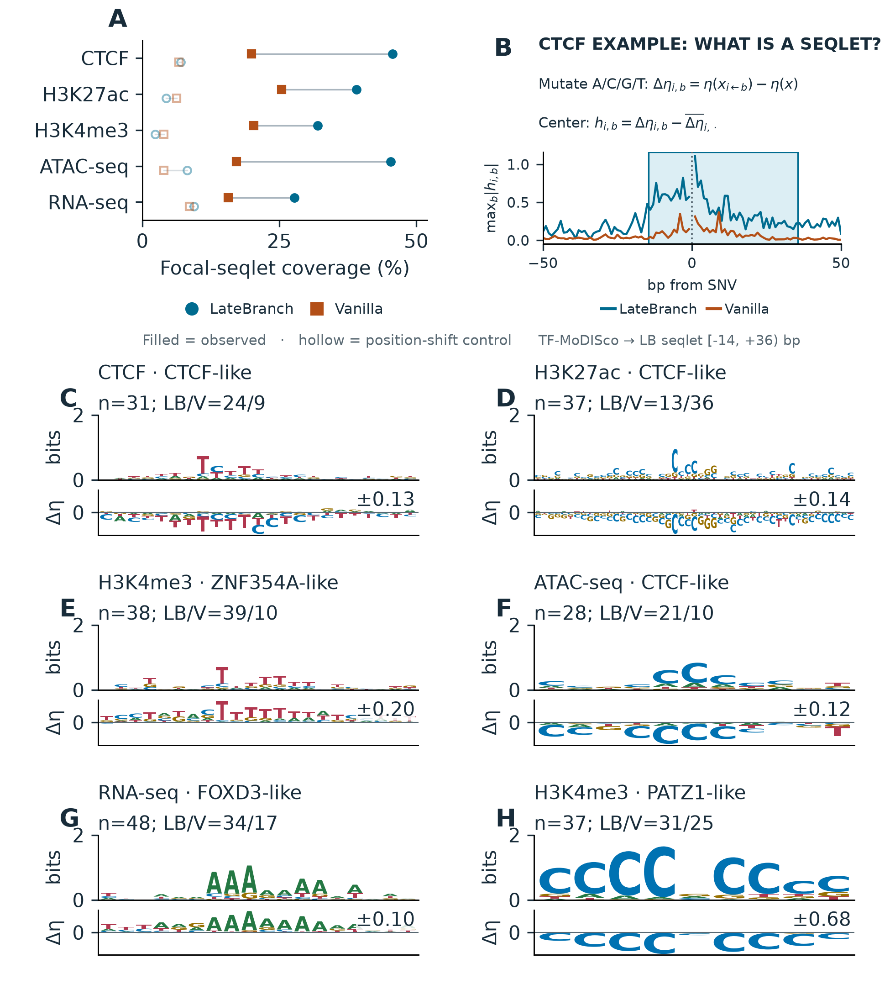
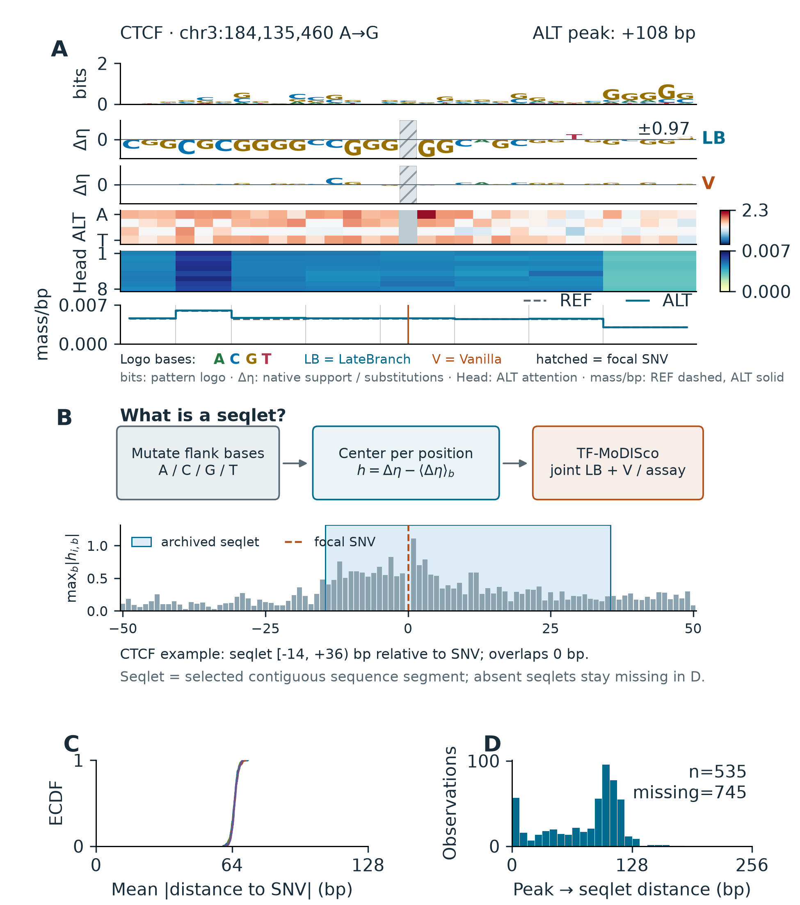

# Figure previews

The four plates are preserved from the [six-page report](../reports/positive.pdf). Panel letters and full captions are in that report. Download PDF/SVG/PNG exports and the four supporting tables from the [release](https://github.com/XiangqiWang77/latebranch-dnabert/releases/tag/v0.1.0).

1. **Design and encoding.** Count targets, shared reference context, candidate branches, within-token position and observed token geometry. [Description](overview.description.txt).

   

2. **Predictive evidence and calibration.** Full-population density plots, window and held-out-chromosome partition schematics, independent assay-scale calibration, and the measured NLL cost of omitting it. [Description](prediction.description.txt).

   

3. **Sequence patterns.** ATCG logos and focal-seqlet coverage from the historical balanced interpretation cohort. [Description](patterns.description.txt).

   

4. **Seqlet and attention.** A CTCF case with a track legend, a measured seqlet example and extraction workflow, plus population attention-distance distributions. [Description](attention.description.txt).

   

The pattern and attention plates describe an earlier model and cohort. They are not causal evidence for the position gate in the released count-only checkpoint.
